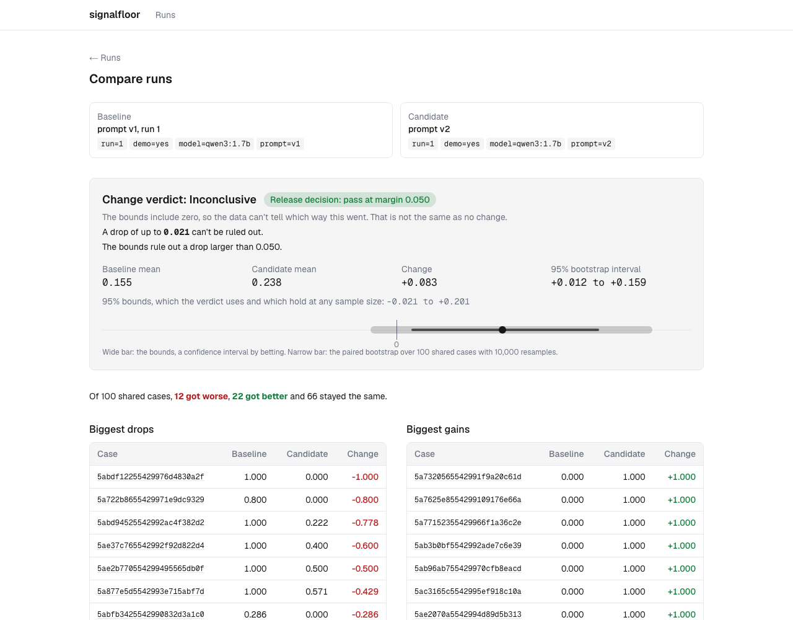

# signalfloor

[](https://pypi.org/project/signalfloor/)
[](https://pypi.org/project/signalfloor/)
[](https://github.com/dch2r/signalfloor/actions/workflows/ci.yml)
[](LICENSE)

Find out if a drop in your LLM eval scores is a real regression or just noise.

## The problem

You change a prompt, switch to a new model, or tweak your retriever. You rerun your evals and
accuracy goes from 82% to 80%. Did you break something?

Most eval tools show you the two numbers and leave the decision to you. But with a few hundred
test cases, a 2 point drop can easily happen by chance. So teams either ship real regressions
because they look small, or waste days chasing changes that were never there.

## Quickstart

Install it, or skip that and run it with [uv](https://docs.astral.sh/uv/) as `uvx signalfloor`.
Python 3.11 or newer.

```bash
pip install signalfloor
```

Get two small example runs, 120 cases each, into an empty folder:

```bash
mkdir signalfloor-try && cd signalfloor-try
for f in baseline candidate-worse candidate-same; do
  curl -fsSLO https://raw.githubusercontent.com/dch2r/signalfloor/v0.5.1/examples/$f.jsonl
done
```

Each line is one test case with an id and a score: `{"id": "q-000", "score": 1}`. Compare the
baseline with a candidate that got worse:

```console
$ signalfloor compare baseline.jsonl candidate-worse.jsonl --seed 0
cases       120
baseline    0.7500
candidate   0.5833
change      -0.1667  (bootstrap 95% CI -0.2750 to -0.0583)
bounds      -0.3119 to -0.0192  (95% at any sample size, the calls below use these)

verdict     regression
```

The exit code is 1, so this fails a CI job. The verdict comes from the bounds. The bootstrap
interval is shown as a quick estimate, and `--seed` only fixes that one.

To decide whether to ship, give the largest drop you accept with `--margin`:

```console
$ signalfloor compare baseline.jsonl candidate-same.jsonl --margin 0.1
...
verdict     inconclusive
            the data can't rule out a drop of up to 0.1250
decision    needs more evidence (margin 0.1)
```

| Decision | When | Exit code |
|---|---|---|
| pass | the lower bound is at or above `-margin` | 0 |
| fail | the upper bound is below `-margin` | 1 |
| needs more evidence | anything else: 120 cases can't tell | 3 |

Here 120 cases can't rule out a drop of 0.125, so a margin of 0.1 gets needs more evidence. The
margin should come from what a drop would cost your users, chosen before you look at the
result. When the eval can't decide, collect more cases rather than widen the margin. [Using signalfloor on your own evals](docs/your-own-evals.md) covers
exporting your results, choosing a margin and what to do with each answer.

## What signalfloor does

signalfloor compares two eval runs and tells you if the difference is real. It works on scores
you already have, from any eval tool.

- `compare` pairs the runs case by case and decides with a confidence interval by betting
  ([Waudby-Smith and Ramdas, 2024](https://arxiv.org/abs/2010.09686)), which is valid at any
  sample size. With a margin it gives a release decision.
- `calibrate` measures how often your LLM judge agrees with human labels, so you know how far
  to trust its scores.
- `flaky` finds test cases whose scores change between identical runs, and how far a rerun's
  mean moves on its own.
- A GitHub Action runs any of them as a CI check.
- A server and dashboard store runs and OpenTelemetry traces, and compare any two runs.

A [validation study](studies/validation) planted regressions of known size into a real agent's
results, 180,000 trials in all. On held-out questions, the rule "fail if the mean dropped by
more than the margin" shipped up to 48% of bad changes and failed up to 42% of good ones.
signalfloor kept both at 0.3% or less. In exchange, small evals often get needs more evidence:
at margin 0.05 it approved 24% of good changes at 100 cases and 47% at 200.
[How signalfloor decides](docs/methodology.md) explains the method and why it replaced a
bootstrap.

## Compare two eval runs

Scores can be numbers or true/false, higher is better. They must lie between 0 and 1 unless you
give another range with `--score-range`, for example `--score-range 1 5` for a judge that scores
1 to 5. Both runs must contain the same case ids.

The verdict is `regression`, `improvement` or `inconclusive`. Inconclusive means the bounds
contain zero, which is not the same as no change: a small eval can be inconclusive about a large
drop, so the command says how large a drop it can't rule out. On 20 questions from the
reference agent:

```console
$ signalfloor compare v1.jsonl v2.jsonl --margin 0.02
cases       20
change      +0.0039  (bootstrap 95% CI -0.1306 to +0.1513)
bounds      -0.2494 to +0.2740  (95% at any sample size, the calls below use these)

verdict     inconclusive
            the data can't rule out a drop of up to 0.2494
decision    needs more evidence (margin 0.02)
            20 cases can't rule out a drop of 0.2167 even if nothing changed
            when nothing changes, a margin of 0.02 needs at least 249 cases
```

When it can't decide, the command says how many cases the margin takes when nothing changed. An
eval with a clear improvement can pass with fewer, and one with losses needs more. Needs more
evidence fails a CI job too. Without `--margin` the command exits with code 1 only for a
regression.

Run `signalfloor compare --help` for every option, including `--format json`.

## Check if your LLM judge can be trusted

If an LLM judge scores your outputs, label a sample of the same cases yourself and check how
often the judge agrees with you. Put the judge labels and the human labels in two files:

```json
{"id": "a-001", "label": 4}
{"id": "a-002", "label": 2}
```

Labels can be numbers, true/false or text, but one type throughout both files: a mix of
numbers and text is refused. Weighted agreement, below, needs numbers. The example files are in
the repository's [examples](examples) folder. Then run:

```console
$ signalfloor calibrate examples/judge.jsonl examples/human.jsonl --weights quadratic
cases       120
labels      1, 2, 3, 4, 5
weights     quadratic
agreement   86.7%
kappa       0.955  (95% CI 0.929 to 0.975)
judge bias  +0.133  (more lenient than humans)

judge \ human       1      2      3      4      5
  1                 9      0      0      0      0
  2                 2     12      0      0      0
  3                 0      2     15      0      0
  4                 0      0      4     41      0
  5                 0      0      0      8     27

verdict     trusted (threshold 0.6)
```

Plain agreement can fool you. If 90% of answers are good, a judge that always says "good"
agrees with humans 90% of the time without checking anything. Cohen's kappa removes the
agreement you would get by chance, so that judge scores 0.

The table shows where the judge goes wrong. Rows are the judge's labels and columns the
humans'. Here every mistake is one step too generous, which is what the positive bias means.

Use `--weights linear` or `--weights quadratic` for ordered ratings like 1 to 5, so a 4 against
a human 5 counts as close. The judge is trusted only when the whole confidence interval is above
the threshold, and the command exits 0 only then. Every label the humans used needs at least 5
examples (`--min-per-label`), or the verdict is inconclusive and says which labels are short.

## Find flaky cases and your noise floor

Run the same eval a few times without changing anything, then pass all the result files. This
is the reference agent run three times with nothing changed:

```console
$ signalfloor flaky v1-run1.jsonl v1-run2.jsonl v1-run3.jsonl
runs        3
cases       100
run means   0.1550, 0.1437, 0.1422
noise floor 0.0099
noise band  +/-0.0425  (95% of reruns stay within this)
            from cases +/-0.0163, from runs +/-0.0425
flaky       3 of 100 cases (3.0%)
note        with 3 runs the estimate from runs is rough. 5 or more make it reliable.

case                      spread  scores
5ae37c765542992f92d822d4  1.000   1 0 0
...
```

The noise band is how far a rerun's mean moves with nothing changed, so a smaller change could
come from rerunning alone. It is estimated from the cases and from the run means, and the larger
wins, because the cases alone miss shifts that move a whole run, like a judge update.

A case is flaky when its score moves between runs. By default any movement counts, which suits
pass/fail scores. For continuous scores set `--tolerance`, for example 0.1. The command exits
with code 1 when more than 5% of cases are flaky. Change that with `--max-flaky-rate`.

## Use it in GitHub Actions

Add a step after the job that produces your eval results:

```yaml
- uses: dch2r/signalfloor@v0.5.1
  with:
    command: compare
    files: evals/baseline.jsonl evals/candidate.jsonl
    options: --margin 0.05
```

The step fails on a regression, and with a margin also when the eval can't show the drop is
within it. The output goes to the job summary. `command` can be `compare`, `calibrate` or
`flaky`, and `options` takes any other command line options. The step also sets an `exit-code`
output.

## Run the whole stack

The stack runs from a clone of the repository, not from the pip package. With Docker and git
installed:

```bash
git clone https://github.com/dch2r/signalfloor.git
cd signalfloor
docker compose up --build -d
```

That starts Postgres, the API, the background worker and the dashboard in the background. The
first build takes a few minutes. Wait until the API reports ready, then load the reference
agent's real runs:

```bash
until curl -fs localhost:8000/health/ready; do sleep 2; done
python3 scripts/load-demo-data.py
```

The loader prints a link to a comparison of the two prompt versions. Open
http://localhost:3000 for the dashboard and http://localhost:8000/docs for the API.
`docker compose down` stops everything, and adding `-v` also deletes the data.



The wide bar is the bounds the verdict uses and the narrow bar the bootstrap interval. Here the
bootstrap says v2 is better, and the bounds can't confirm it on 100 questions.

Set `SIGNALFLOOR_API_KEY` before `docker compose up` to require an API key. The stack is built
for one team on a network it controls. The [server README](packages/server/README.md#api-keys-and-who-this-is-for)
says what that does and doesn't cover.

To run it on Kubernetes, use the Helm chart in [deploy/helm/signalfloor](deploy/helm/signalfloor).
CI installs it on a kind cluster on every pull request, and `scripts/smoke-test.sh` checks the
whole stack. [loadtest](loadtest) has a k6 load test and what it found about where the API
bends under load.

## See it on a real agent

[packages/agent](packages/agent) has a LangGraph agent that answers multi-hop HotpotQA questions
with a local model. It is used to test signalfloor on real agent output. Two findings so far:

- Hybrid search looked like the obvious choice, but at top 2 it was an 8 point recall
  regression against dense search alone, and its small win at top 10 was noise.
- A new prompt raised F1 by about 9 points, about twice the noise band measured from three
  identical reruns, and it also cut retrieval recall by 10 points, which the headline score
  hid. On 100 questions both are likely but not proven: the bootstrap calls them, and the
  bounds fall just short.

The [agent README](packages/agent/README.md) has the numbers and how to rerun them.

## Status

Alpha. The `compare`, `calibrate` and `flaky` commands, the GitHub Action, the server and the
dashboard work today. See the [changelog](CHANGELOG.md) for each release.

| Part | What it is |
|---|---|
| [packages/signalfloor](packages/signalfloor) | The library and CLI, published to PyPI |
| [packages/agent](packages/agent) | A LangGraph agent used to test signalfloor on real output |
| [packages/server](packages/server) | An API that stores runs and traces and compares runs |
| [dashboard](dashboard) | A Next.js web view of the stored runs |
| [studies/validation](studies/validation) | The validation study |
| [docs](docs) | The method, a guide for your own evals, and design records |

## Development

To work on signalfloor itself you need [uv](https://docs.astral.sh/uv/) installed. Then:

```bash
git clone https://github.com/dch2r/signalfloor.git
cd signalfloor
uv sync
uv run pre-commit install --hook-type pre-commit --hook-type commit-msg
createdb signalfloor_test
uv run pytest
```

The server tests need a local Postgres. See [packages/server](packages/server/README.md).
See [CONTRIBUTING.md](CONTRIBUTING.md) for how to send a change.

## License

Apache 2.0. See [LICENSE](LICENSE).
